# Dalin Huang

### Senior AI Developer

I build AI that builds. And the trust that lets it ship. 
Currently at **Parker AI**, taking marketing fully agentic.

What I build there: agent loops that take a ticket to production, self-hosted fine-tuned LLMs, evals across 50+ models, and data pipelines at billions of points a day. Agents earn their autonomy: a kind of change ships by itself once it has a track record, and the long tail still stops at a person. 10+ years shipping production systems.

  

  

  

The panels are replays for show, not live data.

---

**→ [dalin.dev](https://dalin.dev)** · ask a tiny classifier that trains in your browser · explore the career clock · built with Claude Code (Fable 5.2)

  
