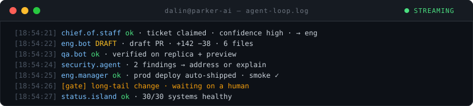

# Dalin Huang

### Senior AI Developer, Agent Systems

I build the AI behind **Parker AI**. And the agents that build it.

Parker AI is taking marketing fully agentic: data, research, production, and shipping, in loops that close themselves and improve with every run. My side of it: agent loops, self-hosted fine-tuned LLMs, evals across 50+ models, and data pipelines at billions of points a day. 10+ years shipping production systems.

  

  

  

The panels are replays for show, not live data.

---

**→ [dalin.dev](https://dalin.dev)** · ask the model · explore the career clock · built with Claude Code (Fable 5.2)

  
